Next: Phase 1, the Pricing Calculator (no AWS account needed)

1. Amazon RDS for PostgreSQL
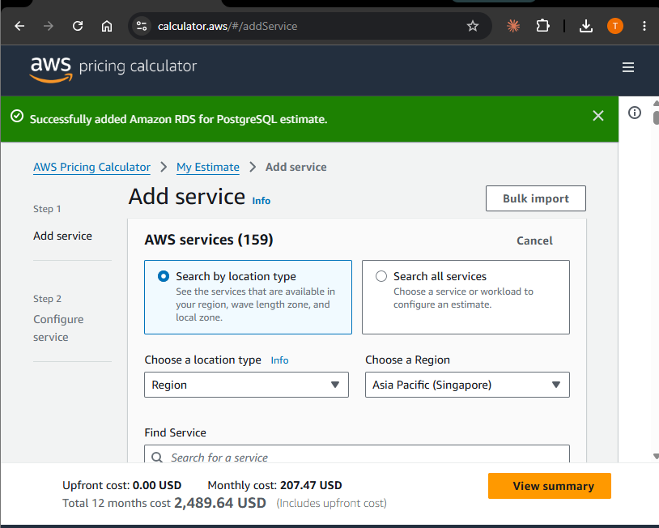

aws fargate
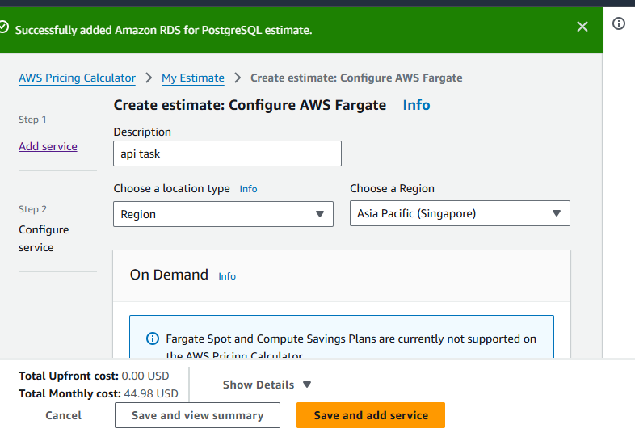

3. Amazon Virtual Private Cloud (VPC)
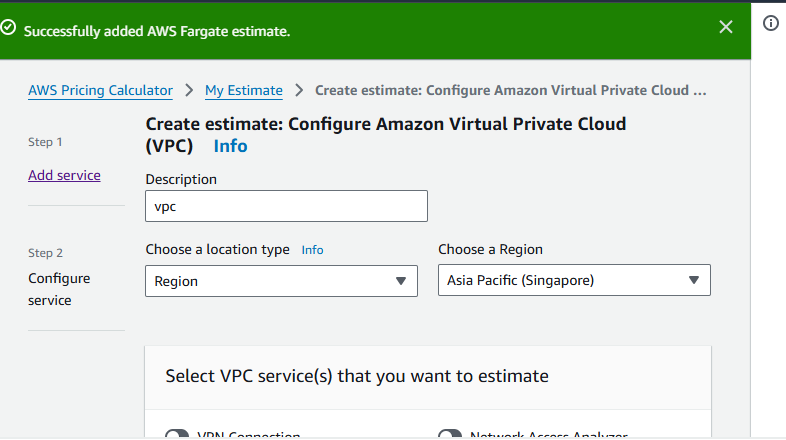

4. Elastic Load Balancing
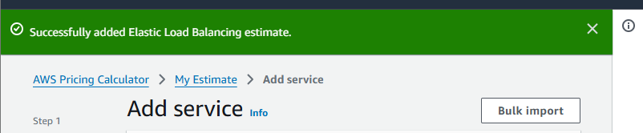

5. Amazon CloudFront
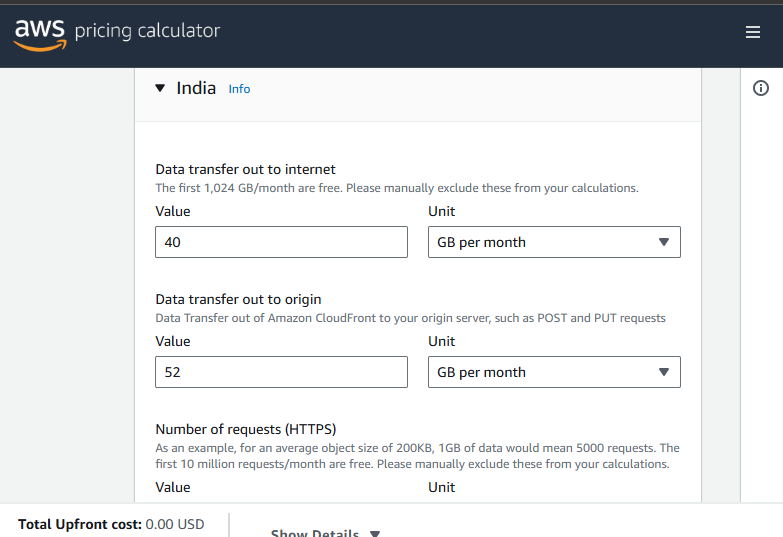

6. AWS WAF
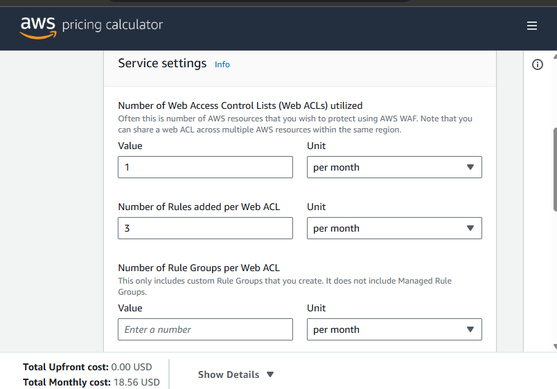
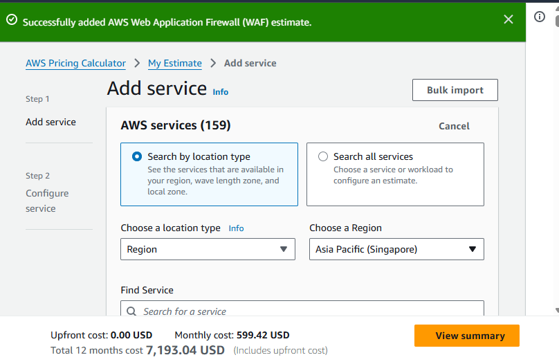

7. Amazon S3
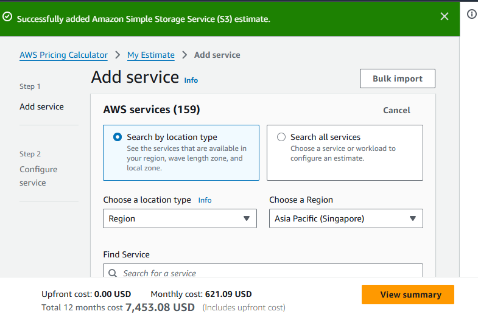

8. Amazon CloudWatch
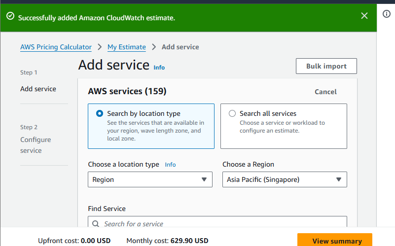

1. AWS Key Management Service (KMS)

2. Amazon Simple Queue Service (SQS)
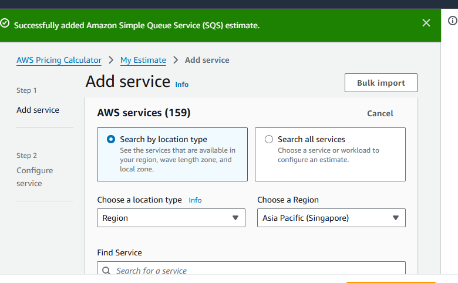

3. AWS Lambda
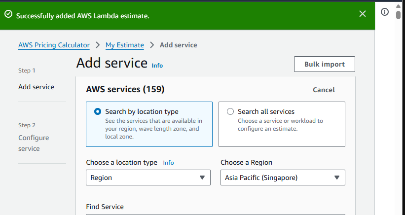

4. Amazon Simple Email Service (SES)
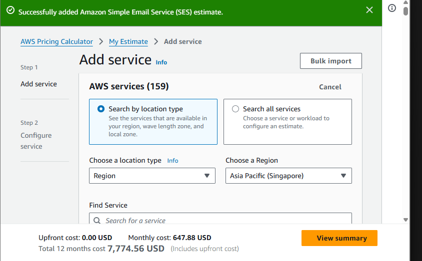

5. AWS Secrets Manager

6. Amazon Elastic Container Registry (ECR)
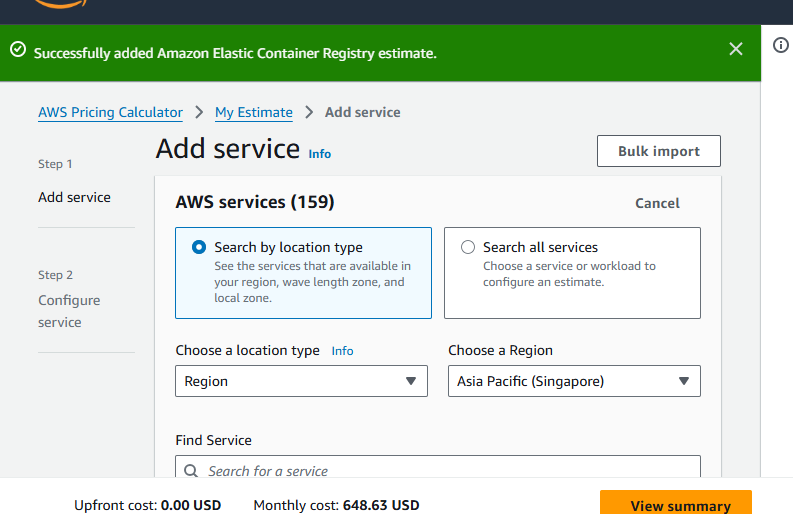

7. Amazon Route 53

8. Amazon Cognito
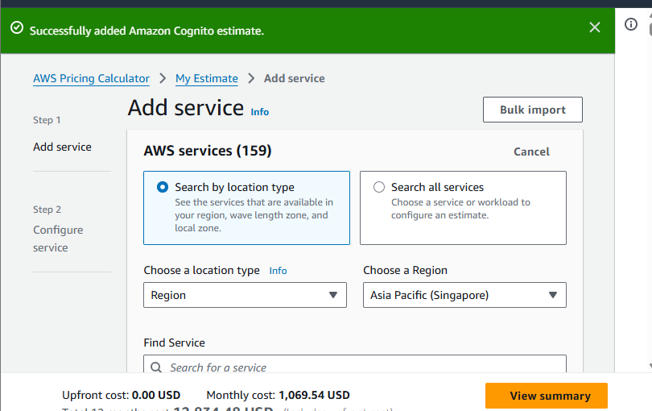

9. AWS Backup
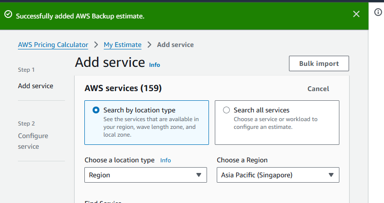

10. AWS Data Transfer
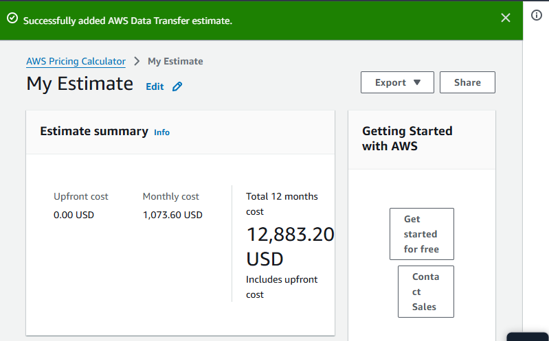

Then finish the NORMAL month
Save and view summary. Check that every service has Region = Singapore.
📸 Screenshot the summary showing the monthly total, the 12-month total and the Region.

the Exam month
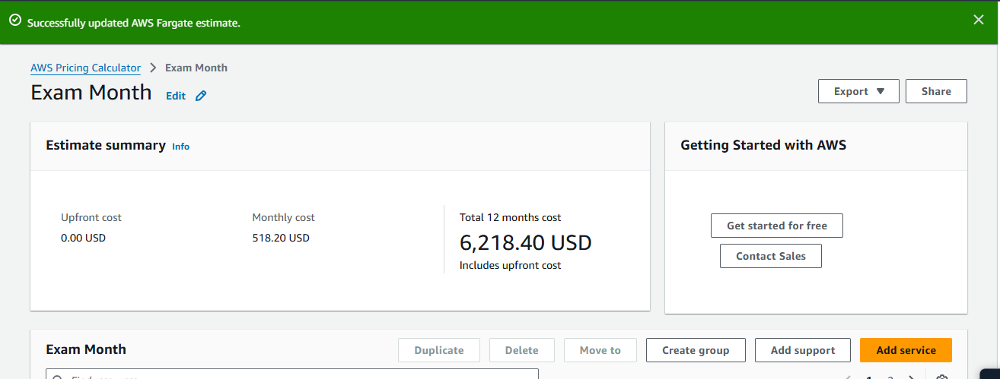

L1: latency from Bhutan

On your laptop in Phuntsholing, open https://www.cloudping.info → HTTP Ping. Note Singapore (ap-southeast-1) and Mumbai (ap-south-1) in ms. Run it 3 times and take the median.
📸 Screenshot it.
latency1

latency2
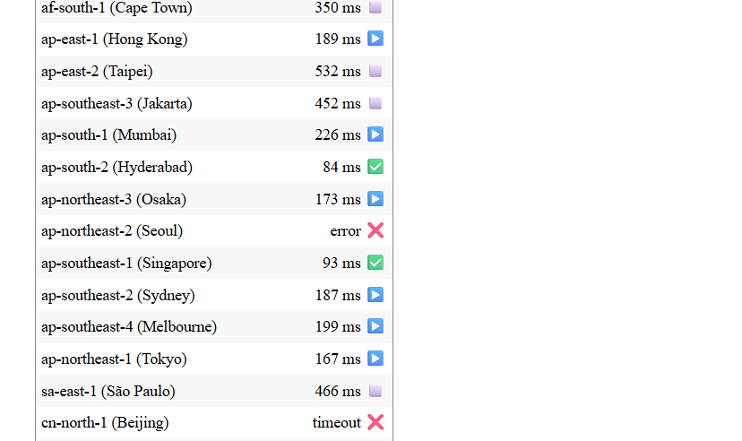

latency3
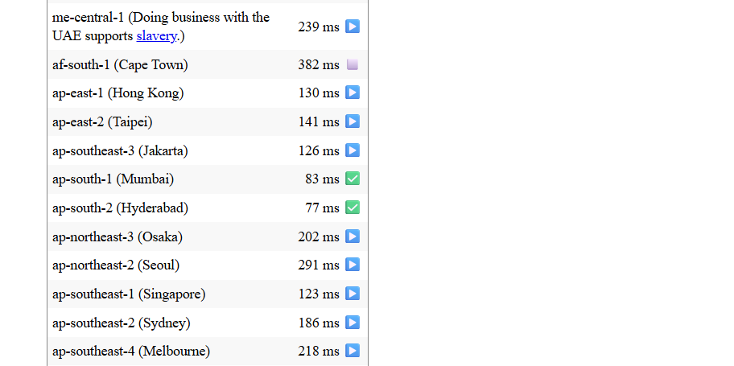

2. Validate and bootstrap (5 min)
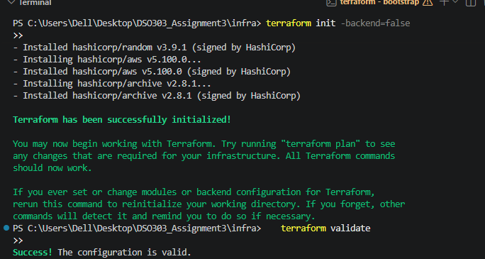
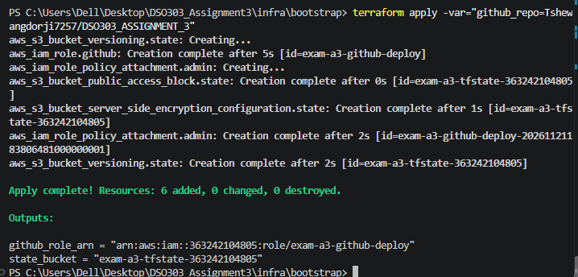

Next: GitHub settings

In Tshewangdorji7257/DSO303_ASSIGNMENT_3 → Settings → Secrets and variables → Actions:

Secrets tab → New repository secret
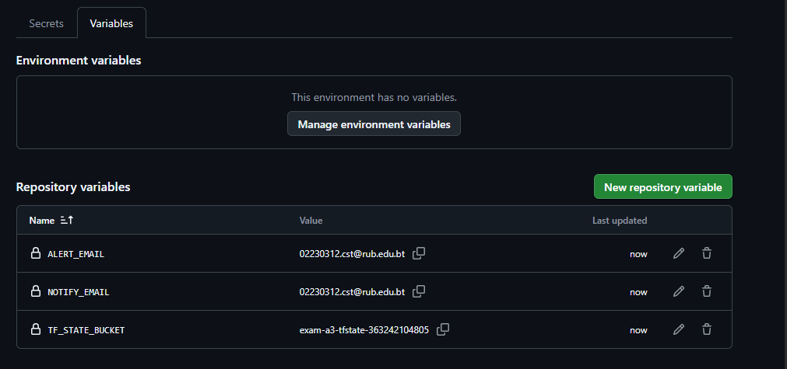
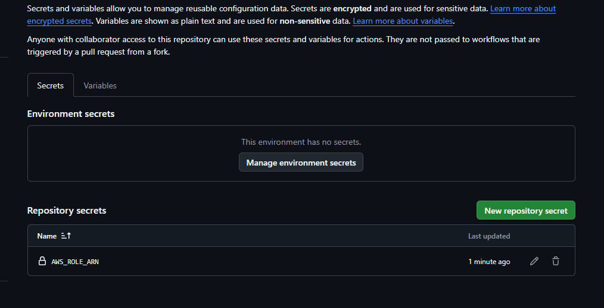