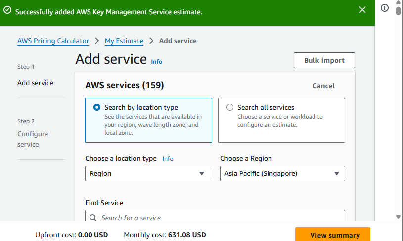
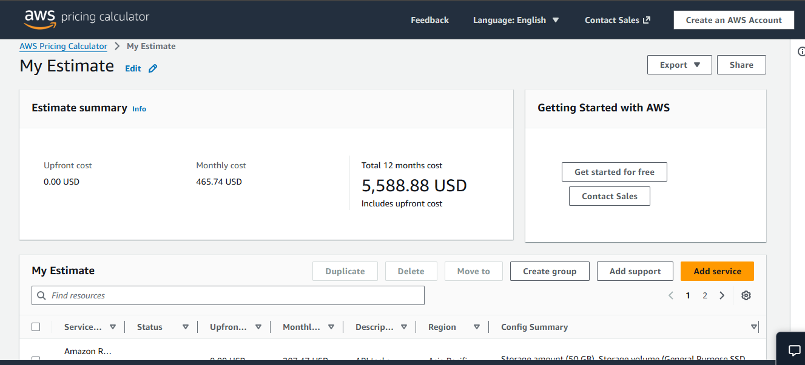
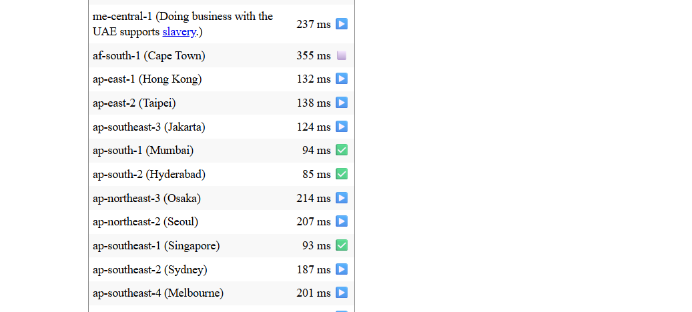
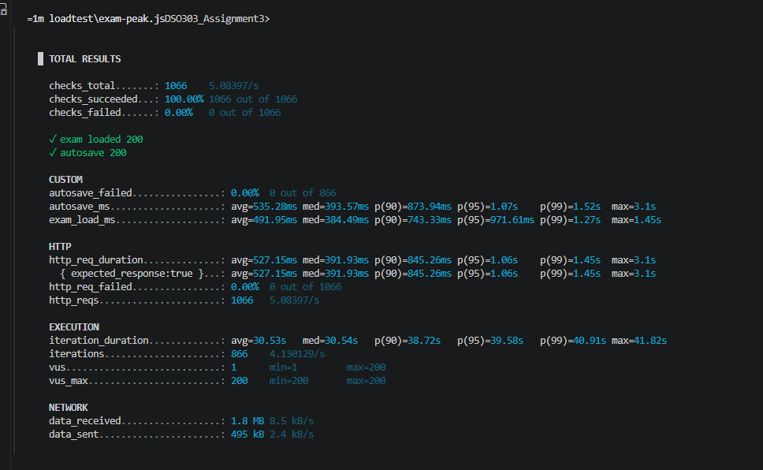
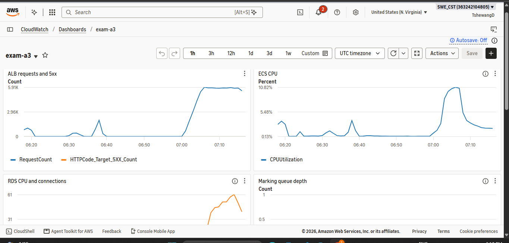
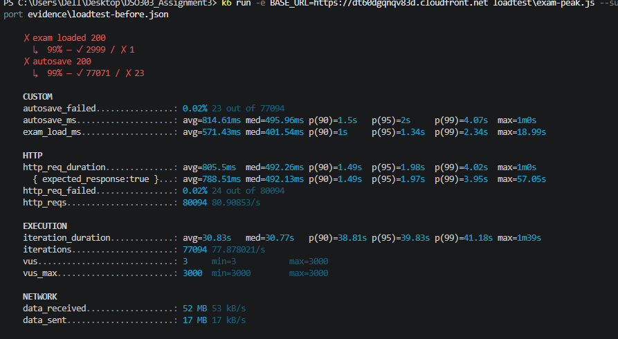
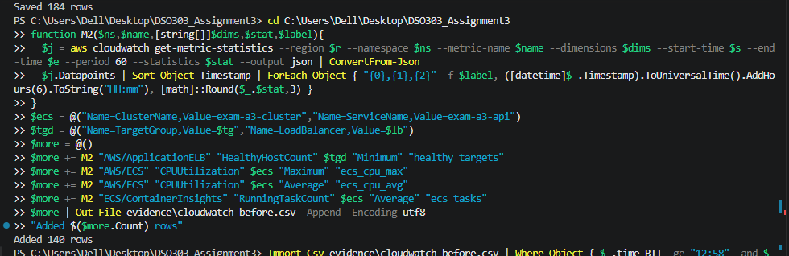
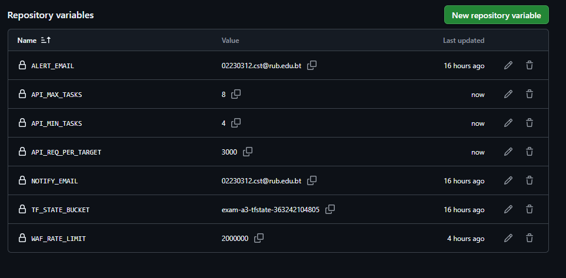

Next: Phase 1, the Pricing Calculator (no AWS account needed)

1. Amazon RDS for PostgreSQL

aws fargate

3. Amazon Virtual Private Cloud (VPC)

4. Elastic Load Balancing

5. Amazon CloudFront

6. AWS WAF

7. Amazon S3

8. Amazon CloudWatch

1. AWS Key Management Service (KMS)

2. Amazon Simple Queue Service (SQS)

3. AWS Lambda

4. Amazon Simple Email Service (SES)

5. AWS Secrets Manager

6. Amazon Elastic Container Registry (ECR)

7. Amazon Route 53

8. Amazon Cognito

9. AWS Backup

10. AWS Data Transfer

Then finish the NORMAL month
Save and view summary. Check that every service has Region = Singapore.
📸 Screenshot the summary showing the monthly total, the 12-month total and the Region.

the Exam month

L1: latency from Bhutan

On your laptop in Phuntsholing, open https://www.cloudping.info → HTTP Ping. Note Singapore (ap-southeast-1) and Mumbai (ap-south-1) in ms. Run it 3 times and take the median.
📸 Screenshot it.
latency1

latency2

latency3

2. Validate and bootstrap (5 min)

Next: GitHub settings

In Tshewangdorji7257/DSO303_ASSIGNMENT_3 → Settings → Secrets and variables → Actions:

Secrets tab → New repository secret

Then deploy
Actions → deploy → Run workflow → main → Run workflow.

Now the load test: 2 marks, and the hardest criterion to get full marks on. Follow this order.

Step 1: Install k6 (2 min)

Step 2 (optional, worth doing): prove the WAF bottleneck first (5 min)

The WAF rate limit is still 2,000 requests per 5 min per IP. Run a small test from your one IP. It acts like a class sharing one campus IP, and WAF will block it, which turns this reasoned bottleneck into a proven one:

CloudWatch → Dashboards → exam-a3, time range last 30 minutes → screenshot the "WAF blocked requests (rate limit)" graph. It should show a spike starting a minute or two into the test. 

Next: step 3, raise the WAF limit
GitHub → Settings → Secrets and variables → Actions → Variables → New repository variable: WAF_RATE_LIMIT = 2000000
Actions → deploy → Run workflow (about 3–5 min).
When it's green, run the smoke test:

Next: the full BEFORE test (3,000 students, about 16 min)

Settings unchanged: 2 tasks, db.t4g.micro, pool 10.

Open the dashboard first: CloudWatch → Dashboards → exam-a3 → time range 1h, refresh 1 min.

k6 summary

Next: pull the CloudWatch numbers for the test window

The test ran from about 13:01 to 13:18 your time (07:01–07:18 UTC). If you took dashboard screenshots, send them. In any case, run this script. It saves the key metrics minute by minute to a CSV, which is hard evidence, and I can analyse it exactly:

The fix: right-size scaling from the measured capacity

2 tasks handled 2,900 req/min each at 17% CPU. So:

Target 3,000 requests per task per minute (about 50/s, still only ~20% CPU)
Pre-scale to 4 tasks (2 per AZ) during exams, so one AZ alone can carry the whole peak
Max 8 tasks, which keeps DB connections ≤ 80

The 300 target is currently hard-coded, so make it a GitHub variable. Three small edits:

Then:

Add GitHub Variables
