# Failure test scenarios

**Region:** ap-southeast-1 (Singapore), two AZs.
**Targets:** RPO 5 minutes, RTO 1 hour, survive the loss of one AZ, files kept for 5 years.

**How each test is measured.** Run `scripts/probe.ps1` during every test. Each second it calls `/api/health` and sends an autosave, and logs the result to `evidence/probe-<name>-*.csv`. When stopped, it prints:
- **DOWNTIME**: first failed request → first success (compare with RTO)
- **DATA LOSS**: last *acknowledged* autosave compared with what is in the database (compare with RPO)

---

## F1: RDS primary fails (AZ failure of the database): measured, fixed twice, re-tested

| | |
|---|---|
| **Trigger** | `aws rds reboot-db-instance --db-instance-identifier exam-a3-db --force-failover` (= RDS console → Reboot → *Reboot with failover*) |
| **Expected impact** | The writer moves to the standby in the other AZ; the endpoint name stays the same. Autosaves fail only while the DB switches (~30–60 s). **No committed data lost** (synchronous replication) |
| **Expected vs targets** | RPO ≈ 0 (target 5 min). RTO ≈ 1–2 min (target 60 min) |
| **Evidence** | `evidence/probe-rds-failover-*.csv` (1 line per second), RDS events (failover started/completed), ECS service events, API logs, primary AZ before/after |

### Measured results: three runs

| | **Run 1: as deployed** | **Run 2: + ALB liveness fix** | **Run 3: + crash fix** |
|---|---|---|---|
| Time (22 Nov, BTT) | 20:09 | 20:26 | 20:39 |
| RDS failover (events) | started 20:09:12 → completed 20:10:01 (49 s) | started 20:26:46 → completed 20:27:31 (45 s) | started 20:39:11 → completed 20:40:01 (50 s) |
| Primary AZ | 1a → 1b | 1b → 1a | 1a → 1b → **1a** (swapped back) |
| **API outage seen by users** (probe: first failure → first OK) | 20:09:08 → 20:10:37 = **89 s** | 20:26:44 → 20:28:00 = **76 s** | 20:39:11 → 20:39:27 = **16 s** |
| Failed probe seconds | 41 | 30 | **4** |
| Error types | 503 ×26, **502 ×9–11**, timeouts ×5 | 503 ×13–14, **502 ×10–12**, timeouts ×5 | 503/500 ×3, timeout ×1, **no 502** |
| **ECS tasks replaced** | **All 4** (deregistered 20:10:06, new tasks 20:10:17–35, old exited code 1) | **All 4** (draining 20:27:38, restarts 20:27:54–20:28:07) | **None** |
| Acknowledged autosaves lost (read-back after the test) | **0** (last ack #484 = DB #484) | **0** (#289 = #289) | **0** (#162 = #162) |
| **RTO 1 h** | ✔ (89 s) | ✔ (76 s) | ✔ (16 s) |
| **RPO 5 min** | ✔ 0 lost (synchronous standby) | ✔ 0 lost | ✔ 0 lost |

Baseline run (19:54, no failure triggered): 236 s probed, **0 failed requests**: steady state is clean.

### Root cause analysis
1. **Deep health check used by the ALB (run 1).** The target-group health check was `/api/health`, which runs `SELECT 1`. When the DB failed over, **every task failed its health check at the same time**, so the ALB deregistered all of them and ECS replaced the whole service. A 49-second DB failover became an 89-second total API outage with **502 (no healthy targets)**.
   **Fix 1:** new `/api/live` liveness endpoint (no DB) for the ALB; `/api/health` stays as the deep check for the smoke test and monitoring (`infra/compute.tf`, `app/api/server.js`).
2. **Unhandled async errors crash Node (run 2).** `express-async-errors` was in `package.json` but **never `require`d**. When the autosave route's `await pool.query()` failed with `ECONNREFUSED`, the rejection was unhandled and **Node 20 exited (code 1)**, so each task crashed on its next autosave and ECS restarted all 4. This bug would also crash the API on *any* DB error in normal operation.
   **Fix 2:** `require("express-async-errors")` so route errors become HTTP 500 via the error middleware; `pool.on("error")` and `process.on("unhandledRejection")` handlers log instead of crashing.
3. **Result (run 3):** the API stays up through the failover. Students see **~16 s** of failed autosaves (retried by the browser every 30 s), with no restarts and no 502s. Outage **−82 %** (89 s → 16 s).

### Remaining improvements
- **RDS Proxy** (C13): holds client connections open during failover, shortening the 16 s error window further.
- Client-side **retry with back-off** for autosave (the browser already retries every 30 s, so at most one save is delayed).
- **Lesson:** liveness checks must not depend on downstream services; deep checks belong in monitoring, not in load-balancer routing.

### Evidence (screenshots)

**Probe running (window 1): one health check + one autosave per second**

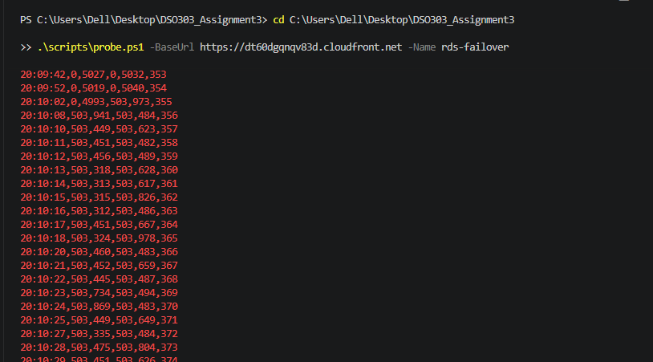

**Failover triggered from the CLI and RDS events polled**

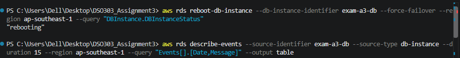

**Probe during the failover: red lines while the database switches**

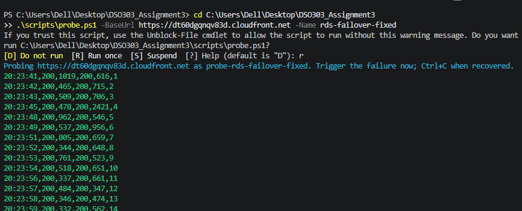

**Trigger command: `reboot-db-instance --force-failover` → rebooting**

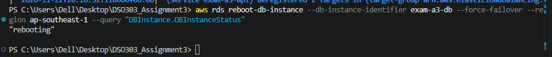

**RDS events: Multi-AZ failover started → DB restarted → failover completed**

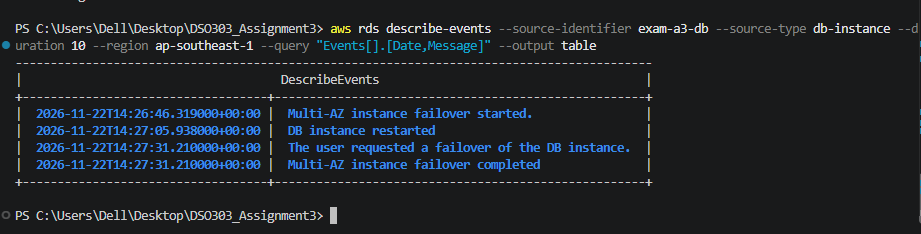

**After the failover: ECS service events, API logs (ECONNREFUSED, restarts) and the new primary AZ**

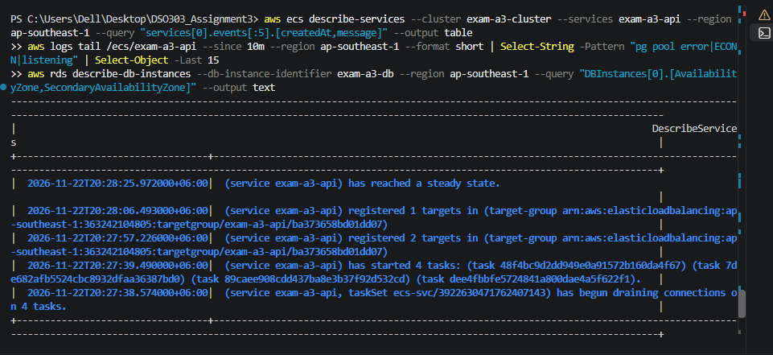

*To add:* `fail-F1-summary.png`, a screenshot of the CSV summary of all three runs (89 s / 76 s / 16 s).

## F2: Loss of one AZ for compute (AZ-a app subnet isolated): measured

| | |
|---|---|
| **Trigger** | A **deny-all network ACL** was associated with the AZ-a app subnet `exam-a3-app-1` (`aws ec2 replace-network-acl-association`), cutting the 2 AZ-a API tasks off from the ALB, NAT and RDS. This is closer to a real AZ outage than stopping tasks. Restored by re-associating the original ACL and deleting the deny ACL |
| **Isolation window** | **20:47:08 → 20:49:05** BTT (≈ 2 min), 22 Nov 2026 |
| **Expected impact** | ALB health checks (15 s × 3) mark AZ-a targets unhealthy within ~45 s; AZ-b tasks carry all traffic (load test: 2 tasks handle the full peak at 17 % CPU); ECS replaces the unhealthy tasks. A few requests already routed to AZ-a time out |
| **Expected vs targets** | Partial errors ≤ 45 s; no full outage; RPO 0 (database untouched) |

### Measured
| Evidence | Result |
|---|---|
| **Probe** (`evidence/probe-az-a-loss-20261122-204540.csv`, 133 s) | **5 failed probe seconds**, all **timeouts** (status 0), between **20:47:08 and 20:47:42**, i.e. **34 s of intermittent errors**; **no full outage** (the other ~30 probes in that window succeeded via AZ-b) |
| **ALB targets** (CloudWatch per minute) | 20:46 healthy **4** / unhealthy 0 → **20:47 healthy 2 / unhealthy 2** → 20:48 healthy 3 / unhealthy 1 → 20:49 healthy 5 (replacement + restored) / unhealthy 0 |
| **ECS** (service events, task list) | **20:48:17** replacement task started in **ap-southeast-1b** (the healthy AZ); **20:48:30** unhealthy AZ-a target deregistered and drained; after restore, **20:49:22** a new task started in **1a** and at **20:50:05** ECS stopped one surplus task, rebalancing back to **2 + 2 across AZs** |
| Acknowledged autosaves lost | **0** (last acknowledged #133 = database #133) |

### Verdict
| Target | Result |
|---|---|
| **Survives loss of one AZ** | ✔ Service stayed up: 2 AZ-b tasks carried all traffic; failures limited to in-flight requests to the dead AZ |
| **RTO 1 h** | ✔ 34 s of intermittent errors; full capacity restored by ECS within ~70 s (20:47:08 → 20:48:17 replacement in AZ-b) |
| **RPO 5 min** | ✔ Database unaffected; failed autosaves are retried by the browser |

### Likely fix / improvement
- **Faster detection:** health check every **5 s** with 2 failures (≈ 10 s instead of ~45 s), so fewer requests reach a dead AZ.
- **Size for one AZ:** keep **≥ 2 tasks per AZ** during exam windows (the scheduled pre-scale of 4 tasks does this), so a surviving AZ alone carries the full peak, as measured in the load test.
- **Client retry** on timeout for autosave (idempotent upsert, so retries are safe).

### Evidence (screenshots)

**Before: API tasks spread 2 + 2 across ap-southeast-1a and 1b**

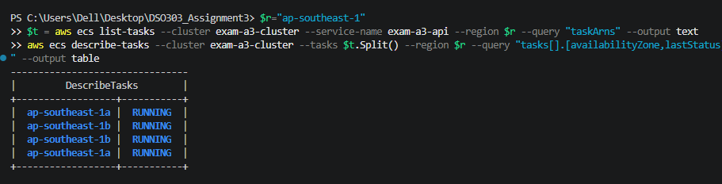

**Deny-all network ACL created, AZ-a app subnet isolated (20:47:08) and restored (20:49:05)**

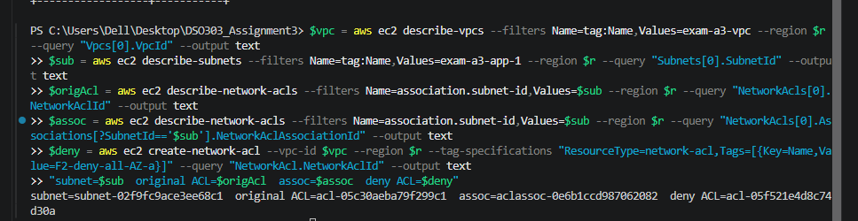

*To add:* `fail-F2-hosts.png` (HealthyHostCount 4 → 2 → 5 / UnHealthyHostCount 0 → 2 → 0, plus ECS events showing the replacement in 1b) and `fail-F2-probe.png` (the probe summary: 5 timeouts, no outage).

## F3: Bad deployment (broken API release): measured, automatic rollback

| | |
|---|---|
| **Trigger** | Commit `c095c0e` changed the ALB liveness route to `res.status(500)` and was pushed to `main`; the pipeline built and deployed it as task definition **`exam-a3-api:6`** |
| **Expected impact** | New tasks fail the ALB health check (`/api/live` → 500). The **ECS deployment circuit breaker** stops the rollout and **rolls back** to the last working revision (`:5`). Old tasks keep serving, so **no user impact** |
| **Expected vs targets** | Downtime 0 s; RPO 0; automatic rollback within minutes |

### Measured timeline (22 Nov 2026, BTT)
| Time | Event | Source |
|---|---|---|
| 21:10:17 | Broken release pushed (`git push`) | terminal |
| 21:12:31 | Deployment **`:6` IN_PROGRESS** next to `:5` (4 tasks serving) | `describe-services` loop |
| 21:13:37 | 4 broken `:6` tasks running but **failing liveness** (500) | loop |
| 21:14:09 | `:6` **failed tasks = 1** | loop |
| **21:14:33** | ECS event: **"rolling back to deployment ecs-svc/5582110365636942848"** (= `:5`) | ECS events |
| 21:14:42 | `:6` **FAILED (failedTasks = 4)**; `:5` PRIMARY again | loop |
| **21:15:45** | ECS: **"deployment completed"**, **"reached a steady state"** on `:5` | ECS events |

### Verdict
| | Result |
|---|---|
| **Detection → rollback** | **2 min 02 s** (broken deployment started 21:12:31 → rollback decision 21:14:33); steady again at 21:15:45 |
| **User impact** | Probe (`evidence/probe-bad-deploy-20261122-210947.csv`, 21:09:47–21:17:15, 344 s): **all 344 autosaves succeeded**; only **2 isolated health-check timeouts** (> 5 s) at 21:13:45 and 21:15:51, both during task transitions (new tasks registering / old revision draining). **No outage**: the 4 `:5` tasks served throughout |
| Data lost | **0** (last acknowledged #344 = database #344) |
| **RTO / RPO** | ✔ / ✔ |
| Pipeline | GitHub Actions run for `c095c0e`: smoke test ___ (expected **passed**, because `terraform apply` does not wait for the ECS rollout and `/api/health` was still answered by the old tasks) |

**Repo restored:** `git revert` of `c095c0e` pushed and deployed as `exam-a3-api:7` (rollback only fixes the running service; without the revert the next push would redeploy the bug).

### Likely fix / improvement
- **Pipeline gap:** the smoke test can pass while ECS is rolling back. Add `aws ecs wait services-stable` (or `wait_for_steady_state = true` on `aws_ecs_service`) **before** the smoke test, and fail the pipeline if the deployment's `rolloutState` is `FAILED`.
- **Blue/green** (CodeDeploy) with a test listener: the new version is health-checked and smoke-tested **before** any production traffic shifts.
- A staging environment for releases before exam weeks; **change freeze** during exam windows.

### Evidence (screenshots)

*To add (take from GitHub and your terminal history):*
- `fail-F3-commit.png`: GitHub commit "F3 test: deliberately broken release"
- `fail-F3-rollout.png`: terminal watch loop (`:6` failed=4 → FAILED, `:5` PRIMARY)
- `fail-F3-ecs-events.png`: ECS events "rolling back to deployment…" and "deployment completed"
- `fail-F3-actions.png`: the GitHub Actions run for that commit (smoke test result)
- `fail-F3-probe.png`: the probe CSV summary (344/344 autosaves OK)
- `fail-F3-revert.png`: the revert commit

Add them like this: ``

## F4: Marking pipeline failure (broken marker Lambda): measured, recovered with DLQ redrive

| | |
|---|---|
| **Trigger** | Marker Lambda environment variable `PGHOST` changed to `wrong-host.invalid` (`aws lambda update-function-configuration`), then exams submitted via `POST /api/exams/1/submit` |
| **Expected impact** | Submit still returns `{"queued":true}`, so **students are not affected**. Each marking attempt fails; SQS retries (visibility 60 s) and after **5 receives** moves the message to `exam-a3-marking-dlq` (14-day retention). The DLQ alarm emails ops. After the fix, a DLQ redrive re-processes the jobs; no result is lost |

### Run A: quick fix (20:53–20:56 BTT)
Marker broken 20:53:45; 3 exams submitted 20:54:06 (all `queued: true`); at 20:54:50 all 3 messages **in flight** (being retried), DLQ 0. Lambda fixed at ~20:55:26, **before** the 5th attempt. The **queued retries succeeded on their own** and all 3 students received a score. *Shows that a fault fixed within ~5 minutes needs no manual recovery: SQS retries are enough.*

### Run B: full DLQ path (20:59–21:08 BTT)
| Time | Event | Evidence |
|---|---|---|
| 20:59:17 | Marker broken | `update-function-configuration` → InProgress |
| 20:59:19 | 3 exams submitted (`f4-student-4..6`), all `queued: true` | students unaffected |
| 20:59:51 → 21:04:19 | marking queue: **3 in flight**, retried every ~60 s | SQS attributes every 30 s |
| **21:04:51** | **DLQ = 3**: messages moved after 5 failed receives (**≈ 5.5 min**) | SQS attributes; console screenshot |
| 21:0x | **DLQ alarm email** `exam-a3-marking-dlq-not-empty` | email screenshot (time: ___) |
| 21:05 | Results for the 3 students: **empty** (not marked) | `GET /api/results/1` |
| 21:07:21 | Lambda fixed (`PGHOST` restored) + **DLQ redrive** (`aws sqs start-message-move-task`) | CLI output |
| ~21:08:06 | Results for all 3 students: **score 0** (correct: they answered nothing) | `GET /api/results/1` |

### Verdict
| | Result |
|---|---|
| Student-facing impact | **None**: submit worked throughout |
| Marking delay | ≈ 9 min (fault → fix + redrive); bounded by detection + fix time |
| **Data lost** | **0 of 3** jobs lost (RPO ✔): kept in the DLQ, re-processed after redrive |
| **RTO** | ✔ ~1 min after the fix (redrive → scores) |
| Alarm | DLQ-not-empty alarm fired (≈ ___ min after the first message reached the DLQ) |

### Likely fix / improvement
- **Faster detection:** alarm on the marker's Lambda `Errors` metric (fires on the 1st failure, not after ~5.5 min when the DLQ fills).
- **Runbook:** fix → `start-message-move-task` (redrive) → verify results; could be automated with a Lambda triggered by the alarm.
- Marking is an **idempotent upsert** (`ON CONFLICT ... DO UPDATE`), so retries and redrives can never create duplicate results.

### Evidence (screenshots)

**Marker Lambda broken: PGHOST changed to wrong-host.invalid**

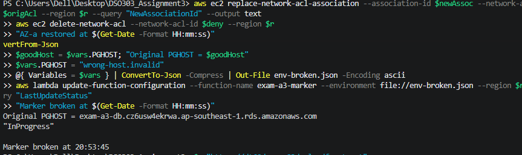

**3 exams submitted while broken: API still answers queued: True (students unaffected)**

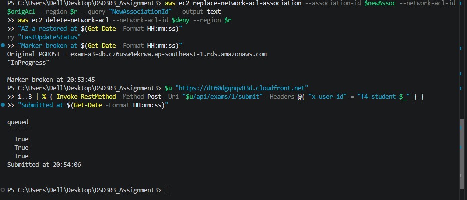

**Run A: queue watched; messages in flight (retried)**

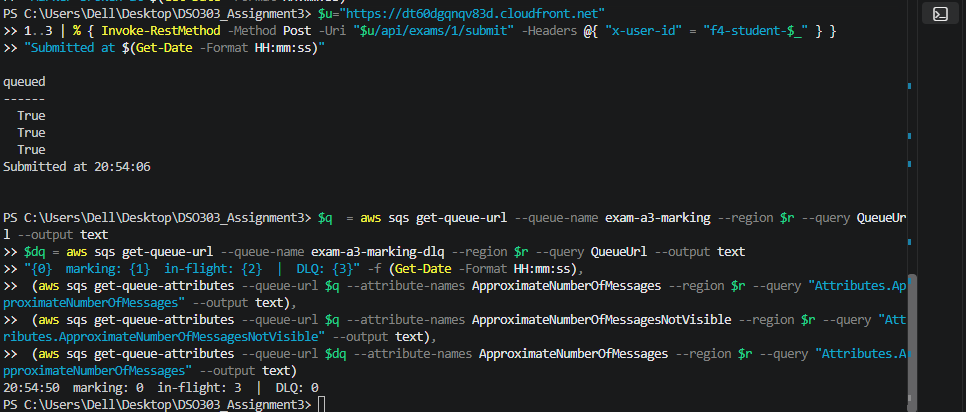

**Run A: Lambda fixed + DLQ redrive started**

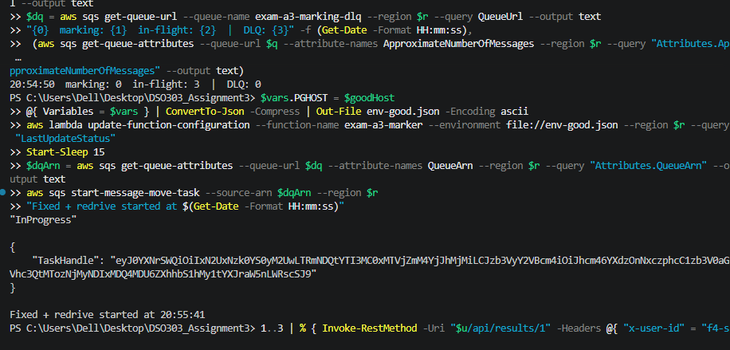

**Run A: results checked: all 3 students scored (no loss)**

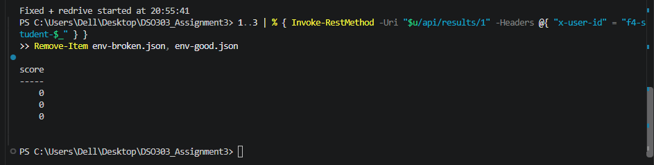

**Run B: full DLQ path: in flight ×3 for ~5.5 min → DLQ = 3 at 21:04:51, then fix + redrive → scores recovered**

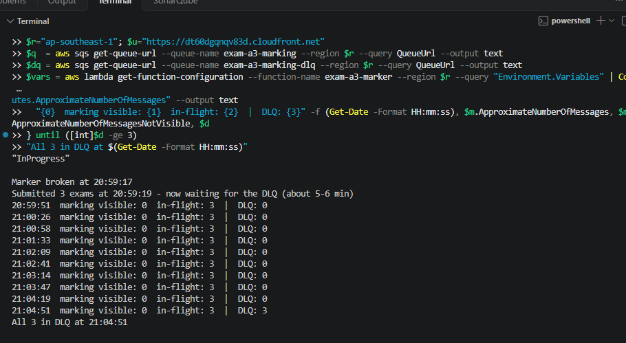

*To add:* `fail-F4-alarm.png`, the "ALARM: exam-a3-marking-dlq-not-empty" email (it shows the time).

## F5 (optional, strongest RTO evidence): accidental data loss → point-in-time restore

| | |
|---|---|
| **Trigger** | Note the time T. Delete a student's answers (e.g. a test row) to simulate a bad change. RDS → `exam-a3-db` → Actions → **Restore to point in time** → T − 1 min → new instance `exam-a3-db-restore` |
| **Expected impact** | Restore time ≈ 15–30 min for a small DB. Then point the app at the new endpoint (Terraform variable or rename). Data is recovered to within minutes of T |
| **Expected vs targets** | RPO ≤ 5 min (PITR granularity). RTO = restore time + switch-over, target ≤ 60 min |
| **Measured** | *Not run (optional): F1–F4 already cover four measured scenarios. Expected restore time for a ~20 GB database: 15–30 min, within the 1 h RTO.* |
| **Likely fix / improvement** | Script the switch-over; consider Aurora (faster clone/backtrack) if RTO becomes tight as the DB grows |

---

## Summary table

**RPO method:** after each test the probe reads the saved answer back and compares it with the last autosave the API acknowledged (HTTP 200). In all five probe runs they matched, so no confirmed answer was lost.

| # | Scenario | Measured downtime | Data lost | RPO 5 min | RTO 1 h | Fix |
|---|---|---|---|---|---|---|
| F1 | RDS failover | 89 s → 76 s → **16 s** (after 2 fixes) | **0** acknowledged saves | ✔ | ✔ | ALB liveness check, require express-async-errors; next: RDS Proxy |
| F2 | AZ-a compute loss (NACL isolation) | 34 s intermittent (5 timeouts), no full outage | **0** | ✔ | ✔ | 5 s health checks, ≥ 2 tasks per AZ in exams |
| F3 | Bad deployment (broken liveness) | **0 s** (344/344 autosaves OK; 2 isolated health timeouts); auto-rollback in **2 min 02 s** | 0 | ✔ | ✔ | Wait for steady state before smoke test; blue/green |
| F4 | Marking Lambda failure (DLQ path) | 0 s for students; marking delayed ~9 min | **0 of 3 jobs** | ✔ | ✔ | Lambda Errors alarm, redrive runbook |
| F5 | PITR restore (optional) | not run | – | (by design ✔) | (expected ✔) | Scripted switch-over |